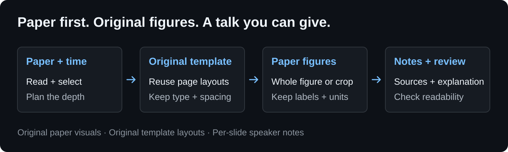

# Build the argument first

**Problem → essential background → idea → mechanism → evidence → limits**

A sequence of understanding, not a fixed slide count.

## Start with paper + time

Reuse supplied inputs; ask only for what is missing. Explain the learning goal, depth, timed structure and backup choices, then continue. [Duration examples](DURATION-GUIDE.md).

## Choose what belongs

| Keep it in… | When… |
|---|---|
| Main talk | It supports or changes the central claim. |
| A short bridge | The next idea needs it. |
| Backup | It helps a follow-up, but the argument stands without it. |
| Omit | It repeats information or serves another question. |

Keep conditions and counterevidence that could change the conclusion visible.

## Background: only the missing prerequisites

Work backward from the mechanism and evidence. Add what the audience needs; subtract what they already know. A concrete failure or minimal baseline creates the need for the idea.

## Mechanism: follow the original figure

Start with the paper's overview. Explain input, operation, output and state through the same figure or its original panels. Keep the figure position stable across focused pages. Use a recorded paper example when available; otherwise a clearly identified oral example can live in speaker notes.

[Figure workflow →](DIAGRAM-GUIDE.md)

## Evidence: one question per figure

| Question | Select from the paper |
|---|---|
| Does it help? | The main comparison and its baseline. |
| Which component matters? | A relevant ablation. |
| What does it cost? | Reported resource/quality evidence. |
| Where does it fail? | A source case, robustness figure or subgroup analysis. |

Use original figures, tables or faithful crops. Preserve labels, axes, units, comparison groups and conditions. Do not redraw or generate content figures. When no suitable original exists, use a large-text takeaway and speaker notes, or omit the material.

[Actual reference slides →](EXAMPLES.md)

## Scope and conclusion

Expand beyond the paper only when the audience goal, time and sources support it. End at a concrete evidence boundary, with a question and a comparison that could resolve it.

## Cover and notes

Once the structure is set, confirm any missing presenter name and school before the cover. Offer applicable prior settings as clearly sourced choices. Continue the body while waiting; users may edit one item, use another institution or omit branding. Details, reading steps and precise sources go in each slide's notes.

Reuse the original template's large type, spacing, figure frames and light palette. Split dense content instead of shrinking it.

[Download the complete skill](https://github.com/ArthurQQQQ/paper-presentation-skill/releases/tag/v1.2.0)
