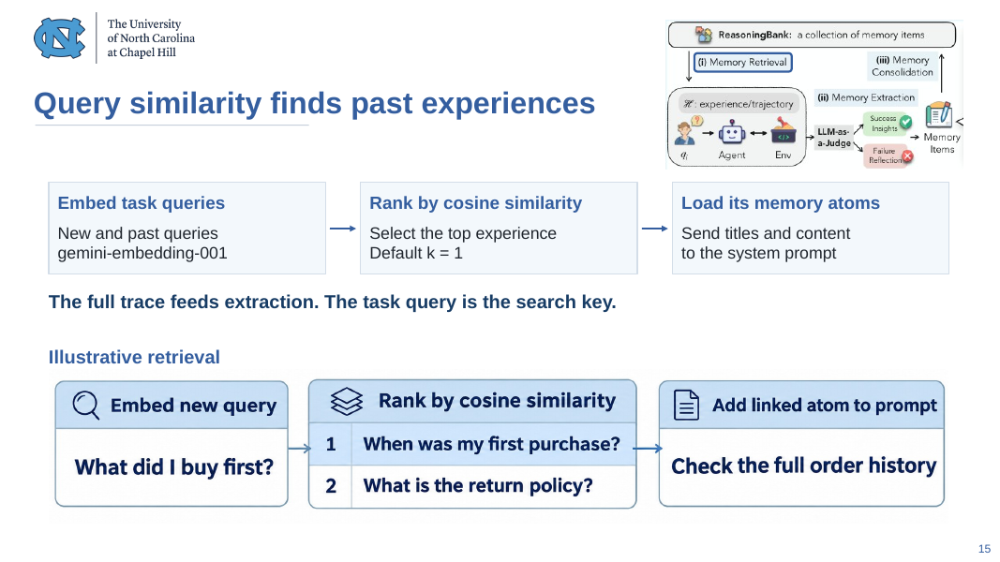
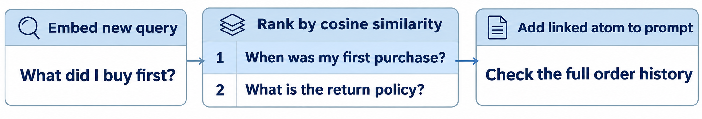

# Diagrams that explain

**Define the relationship. Draw the mechanism. Walk through one example.**



| Layer | What it does | How it is made |
|---|---|---|
| Overview | Shows where we are | Original paper figure + native highlight |
| Mechanism | Explains exact operations | Editable shapes, text and connectors |
| Example | Makes the operation concrete | Embedded blue-and-white teaching image |

## One example, three steps



**Query → ranked experience → linked memory atoms → prompt**

The task query is the retrieval key. The full trace supports judging and extraction. In this example, candidate order and atom wording are teaching choices; the ranking was not measured.

## Make your own

1. **Specify meaning.** Name the objects, states, edges and conditions. Say what each arrow carries and which objects remain separate.
2. **Choose the medium.** Keep exact topology, formulas and changing text native. Generate a bounded illustration only when it improves understanding.
3. **Reveal one dependency.** Keep positions fixed: query first, candidates next, selected atom last. Use consecutive slides when animation is unavailable.
4. **Embed and inspect.** Contain images at their original aspect ratio. Check labels, arrow direction and readability at presentation size. Keep a complete static final state.

For PPTX, retain editable mechanism objects and add the image separately with alt text and source notes. For HTML, use DOM text/SVG connections for the precise layer and an ordinary image for the illustration. PNG text remains rasterized; changing it requires image editing or native reconstruction.

The skill includes this method; use your current presentation tool.

<details>
<summary>Original prompt · exact production text</summary>

Actual ImageGen call: **2026-11-13, 04:52:46.658 UTC**, opaque background. The prefix and composition were joined with one space.

### Shared style prefix

```text
Generate one very wide academic flow diagram for an ICLR computer science paper. Aspect ratio 3:1, tightly composed on pure white. Paper typography: crisp Arial, bold navy labels, pale UNC-blue fills, very thin muted blue-gray outlines and clean simple arrowheads. Small monochrome line icons are fine. No extraneous text or caption, no overall title, no figure number, no shadows, no gradients, no decoration. Large legible type at projected size, preserve exactly the supplied words and do not add or repeat words.
```

### Retrieval composition

```text
Composition: a left-to-right flow of three academic blocks linked by thin right arrows. First block headed “Embed new query” and one example below “What did I buy first?” Second, slightly wider block headed “Rank by cosine similarity” with exactly two rows: “1   When was my first purchase?” and “2   What is the return policy?” Highlight just row 1 in pale blue. Third block headed “Add linked atom to prompt” and one example below “Check the full order history”. The arrow to block 3 starts from the highlighted first-ranked row in block 2. Show no similarity scores, only the two rank numbers. Exactly 3 columns, no additional headings, icons optional only if they don't crowd out text. Fit complete exact wording in large clear type.
```

</details>

<details>
<summary>Source and embedding</summary>

Actual assets from the final 43-page ReasoningBank presentation. The first-purchase task derives from paper Figure 15. The new query, return-policy candidate, ordering and exact atom wording are authored teaching examples, not recorded retrieval output. The mechanism follows Appendix A.2 and the public WebArena implementation.

The generated image was cropped to **2172 × 370 px** at `(0,180)` to remove unused margins. Slide 15 contains it within `x=.65, y=4.82, w=12, h=2.28 in`, preserving its aspect ratio rather than stretching it. The skill retains this exact final crop as `assets/image-references/teaching-retrieval.png`.

Adapt the objects and labels for a new paper. Mark adapted prompts as new; never inherit this example's facts or illustrative ranking as evidence.

</details>
