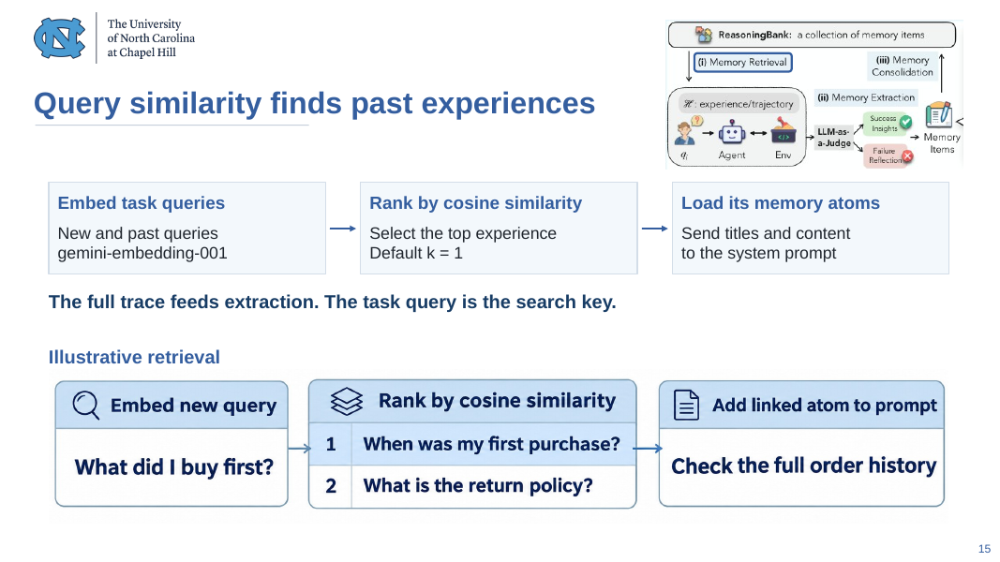
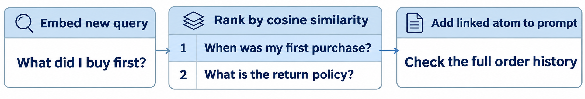
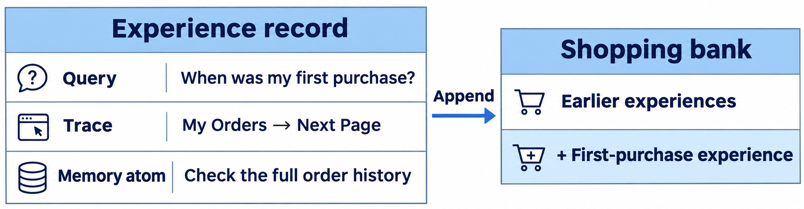
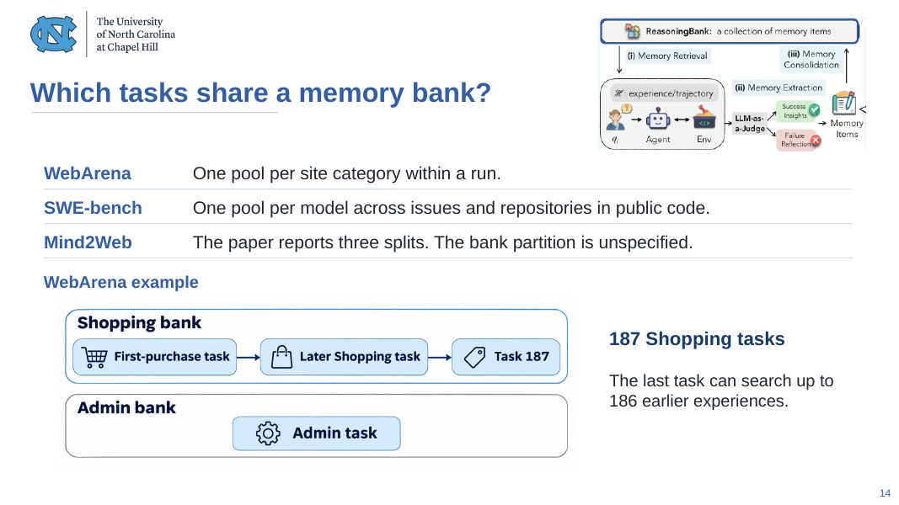
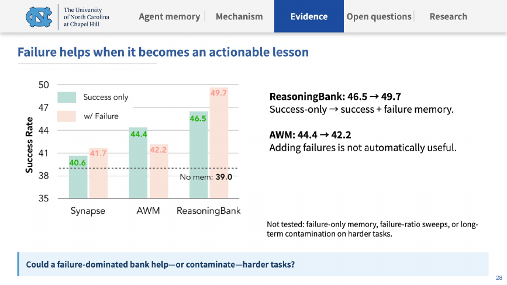
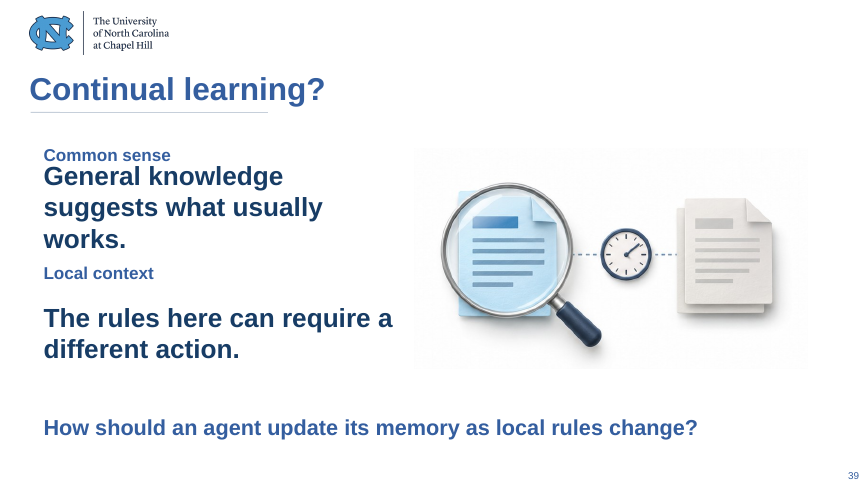

# Actual reference examples

From the approved 43-page ReasoningBank presentation. These are historical reference pages, not a newly generated paper deck. Teaching cases are illustrative. Current talks reuse these layouts with only the presented paper's original figures/tables or faithful crops; historical generated illustrations document the source deck rather than the current default.

## Mechanism + worked example

**Historical production:** editable text, shapes and arrows; an original-paper overview with native highlight; an embedded ImageGen case illustration.

## Retrieve an experience

**Historical production:** explicit objects, exact short labels and bounded ImageGen composition. Candidate order is illustrative; no scores were measured. [Original prompt](DIAGRAM-GUIDE.md).

## Append a record

**Historical production:** one consistent first-purchase example. The diagram distinguishes the query, trace and reusable lesson.

## Show the sharing boundary

**Historical production:** aligned task lanes and a visible isolation boundary; no invented cross-bank arrows.

## Explain evidence

**Historical production:** source-based experimental evidence, a readable comparison and a bounded conclusion. Current talks preserve the presented paper's original result figures and tables.

## Open a discussion

**Historical production:** one concrete research question and a soft conceptual illustration, grounded in the mechanism's limits.

[Back to the homepage](README.md) · [Content decisions](CONTENT-GUIDE.md)
