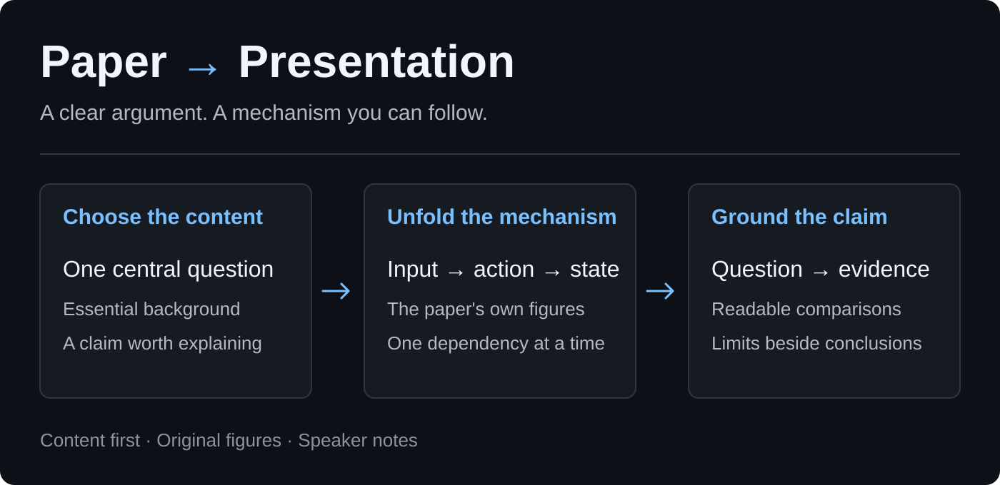
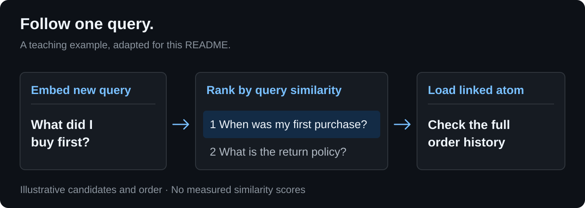

<p align="center">
  <a href="https://github.com/ArthurQQQQ/paper-presentation-skill/releases/download/v1.2.1/reasoningbank-research-slides-v1.2.1.zip">Download skill</a>
  &nbsp; · &nbsp;
  <a href="EXAMPLES.md">Reference slides</a>
  &nbsp; · &nbsp;
  <a href="DIAGRAM-GUIDE.md">Figure workflow</a>
</p>

## Why this skill

- **Content first.** Choose the background, argument and evidence before the layout.
- **Original figures.** Explain the paper through its diagrams, tables and faithful crops.
- **A talk you can give.** Adapt depth to duration; keep detailed explanations and sources in speaker notes.

## Fit the time

**5 min: contribution → 20 min: mechanism + evidence → 60 min: deep seminar**

Give the speaking time; the skill adjusts structure, depth and summarization. [Duration examples](DURATION-GUIDE.md).

## How it works


Reuse the approved ReasoningBank layouts: large type, light slides, clear figure placement. The GitHub showcase uses a dark palette; the presentation retains the original light template.

## Reference example



[Actual reference slides](EXAMPLES.md) · [Figure selection + historical prompt](DIAGRAM-GUIDE.md)

## Use it

1. Download the complete release ZIP and extract.
2. Move `artifact-template-reasoningbank-research-slides` into `~/.codex/skills/`.
3. Give it a paper and time:

```text
Use $artifact-template-reasoningbank-research-slides
Make a 20-minute academic talk from this paper, plus 5 minutes Q&A.
```

After the structure is set, confirm any missing presenter name and school before the cover. Body slides and notes continue while you answer.

<details>
<summary>Package, sources and verification</summary>

The complete v1.2.1 package includes the skill, duration and content guidance, the original 43-page PPTX/PDF, all reference pages and optional previews. Install the release ZIP; this repository contains guides and examples.

The reference deck includes historical ImageGen teaching illustrations. Their original prompt and assets are retained as production records. Current content figures come only from the paper being presented; no image model, model weights or API adapter is bundled. Embedded PNG text remains rasterized; slide titles and conclusions are editable.

The dark visuals above are README artwork and a historical teaching-diagram adaptation. They do not change the original slides. Candidate ranking is illustrative, not measured. New-paper use has been reviewed at storyboard level; complete new-paper rendering remains unverified. Source figures, institutional marks and media retain their attribution. Personal profiles and credentials are excluded.

[Release and checksum](https://github.com/ArthurQQQQ/paper-presentation-skill/releases/tag/v1.2.1)

</details>
