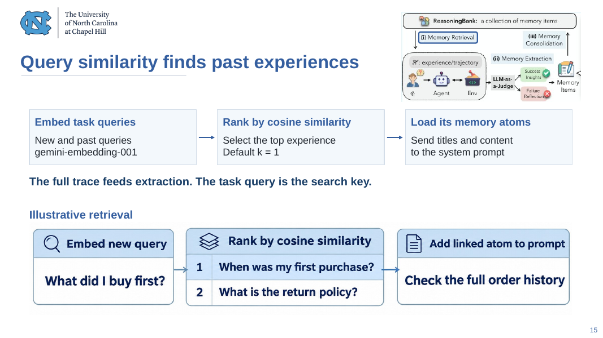
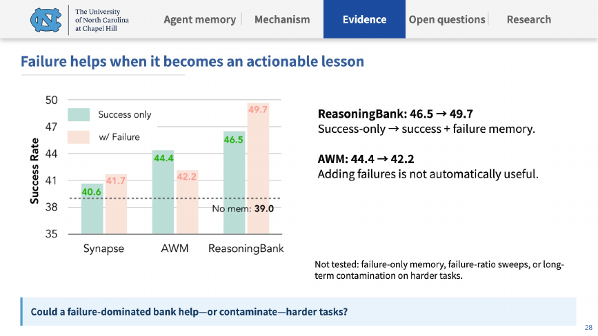
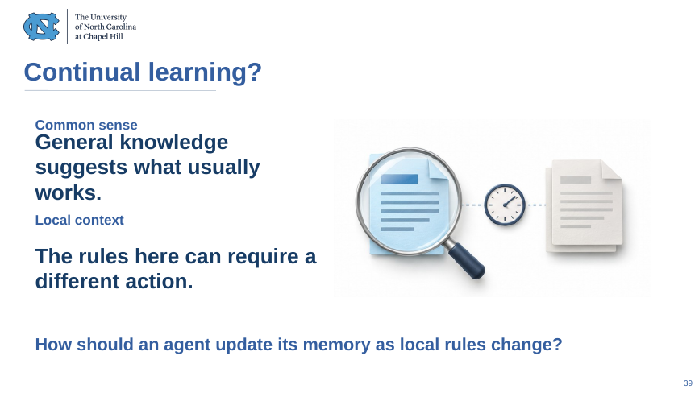

<h1 align="center">Paper → Presentation</h1>

<p align="center"><strong>用图表讲清一篇论文。</strong></p>
<p align="center">从内容取舍到讲述逻辑，让问题、机制和证据连起来。</p>

<p align="center">
  <a href="https://github.com/ArthurQQQQ/paper-presentation-skill/releases/download/v1.0.0/reasoningbank-research-slides-v1.0.0.zip">下载完整 skill</a>
  &nbsp; · &nbsp;
  <a href="CONTENT-GUIDE.md">阅读制作逻辑</a>
</p>

<br>

## 机制，用同一个案例展开

总览定位，局部展开，再让同一个例子走过输入、操作和输出。

<p align="center">
  
</p>

<br>

## 证据，一页回答一个问题

大图呈现比较，短句说明发现，关键限制留在结论旁。

<p align="center">
  
</p>

<br>

## 讨论，从边界打开问题

用大字和留白收束：环境规则改变后，agent该怎样更新记忆？

<p align="center">
  
</p>

以上均为附带的 **ReasoningBank 最终43页参考稿中的实际页面**。

<br>

## 默认流程：先决定讲什么

**问题 → 必要背景与基线 → 关键 idea → 分步机制 → 实验证据 → 结论与限制**

逻辑骨架稳定；页数、背景深度和讨论范围随论文与听众调整。

| 要做的决定 | skill怎样处理 |
|---|---|
| 背景讲多少 | 只补后文机制或结论真正需要、而听众尚未掌握的概念。 |
| 机制怎么讲 | 先看全图，再用稳定案例逐步展开；每页或每次揭示只增加一个理解依赖。 |
| 实验用什么图 | 先确定问题、比较与指标，再选择主收益、消融、代价、泛化或失效的表达。 |
| 要不要扩展主题 | 根据报告目标、证据与时间，选择聚焦论文、有限延伸或general topic。 |

[查看完整内容与选图方法 →](CONTENT-GUIDE.md)

<br>

## 开始使用

**[下载完整 v1.0.0 技能包](https://github.com/ArthurQQQQ/paper-presentation-skill/releases/download/v1.0.0/reasoningbank-research-slides-v1.0.0.zip)** · 约44 MiB · 75个文件

1. 下载Release中的完整ZIP并解压。
2. 将 `artifact-template-reasoningbank-research-slides` 文件夹放入个人Codex技能目录，通常为 `~/.codex/skills/`。
3. 调用skill并给出paper；有需要时补充听众和报告时长。

```text
用 $artifact-template-reasoningbank-research-slides
把这篇paper做成20分钟组会报告。
优先讲清关键idea、机制和证据，由你决定需要多少背景。
```

姓名、学校或其他机构、字号和配色均为**后续可选配置**。

<details>
<summary>完整包、验证范围与来源</summary>

完整安装内容在Release ZIP中；仓库主分支提供首页展示与流程说明。

包内包括skill指令、内容流程、实验选图、图片生成模板、讨论设计、43页逐页分析、原始PPTX/PDF、全部页例及可选交互预览。个人配置与凭据不在包内。

已独立审阅内容流程，并完成有边界的故事板试用；新论文完整成稿的视觉复现仍需在实际制作时检查。上方图片展示的是保留参考稿。

参考稿中的作者、机构标识、研究图表与媒体保留各自来源。它们用于展示表达与视觉方法，新使用者的身份不从参考稿继承。第三方材料的归属与适用条款以原来源为准。

[发布记录与校验文件](https://github.com/ArthurQQQQ/paper-presentation-skill/releases/tag/v1.0.0)

</details>
