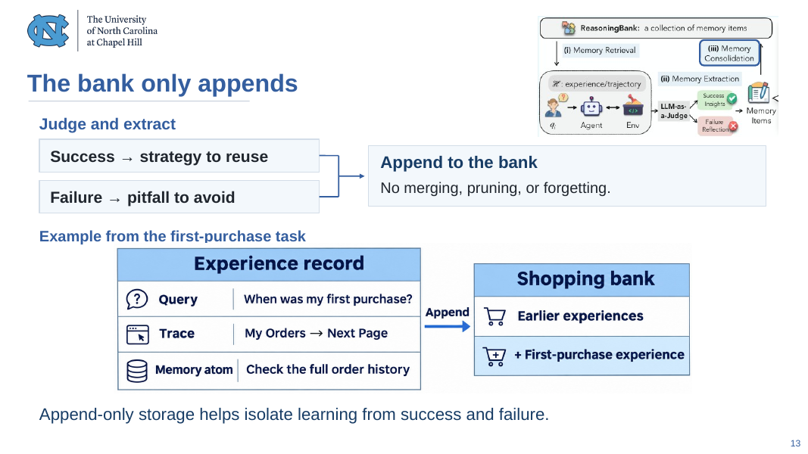
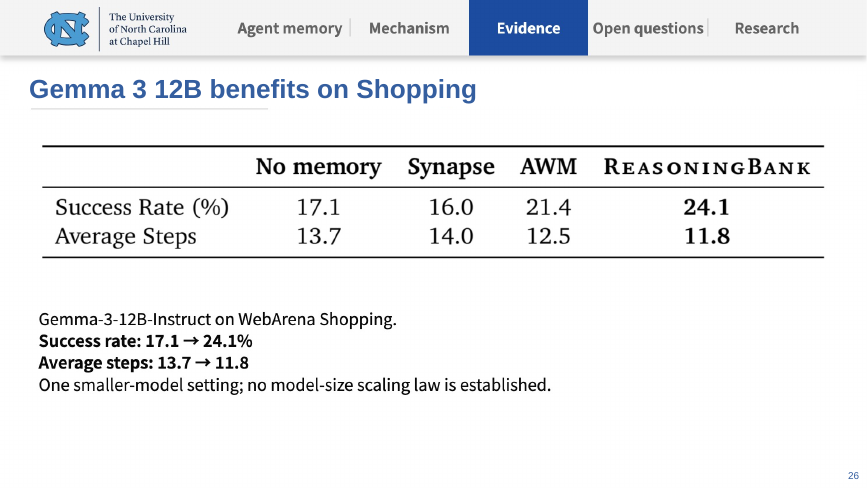

# Paper Presentation Skill

Turn a paper into a clear visual argument. Start with content selection and presentation logic; use figures to explain relationships and evidence. The light ReasoningBank reference style supports the argument.

**Default flow:**

> Problem → necessary background and baseline → key idea → stepwise mechanism → evidence → conclusions and limits

The flow is a sequence of understanding, not a fixed six-slide template. Background depth follows the audience's prerequisites. A stable worked example explains the mechanism. Each experiment figure answers a specific question.

## Download the complete skill

[Download the complete v1.0.0 package](https://github.com/ArthurQQQQ/paper-presentation-skill/releases/download/v1.0.0/reasoningbank-research-slides-v1.0.0.zip)

The release ZIP is the complete installable distribution: instructions, references, the original43-page PPTX/PDF, all43 page renders, image-style references, and optional interactive previews. The full PPTX is larger than GitHub's web-upload limit, so the complete distribution is attached to the release rather than stored as an incomplete source tree here.

This repository's default branch contains the readable workflow guide and example previews. **Install the release ZIP; cloning this repository alone does not install the complete skill.**

## Install

1. Download and extract the complete package.
2. Place the extracted `artifact-template-reasoningbank-research-slides` folder in your personal Codex skills directory, usually `~/.codex/skills/`.
3. Invoke `$artifact-template-reasoningbank-research-slides` and provide the paper. Audience and presentation length can be supplied when relevant.

The skill prioritizes the paper immediately. Name, school/institution, branding, type size, and colors are optional later settings. No installer hook, automatic new chat, or model API credential is required by this package.

## What it teaches

- **Content selection:** main argument, necessary bridge, backup, or omit.
- **Background amount:** keep only concepts needed by a later mechanism, figure, or claim, accounting for what the audience already knows.
- **Mechanism:** show the whole map, then reveal one dependency at a time using a consistent example and stable object positions.
- **Experiments:** choose the comparison, metric, and figure from the question: main gain, ablation, cost, generalization, or robustness.
- **Evidence boundaries:** distinguish results, explanations, teaching illustrations, and hypotheses. Never invent figures or numbers.
- **Discussion:** ask a short question grounded in a concrete gap, with a useful follow-up or discriminating experiment.

Read the [content and experiment guide](CONTENT-GUIDE.md).

## Reference examples

Mechanism first, then a concrete example:

One readable setting with the result and its scope:

These are retained pages from the reference deck, not proof of a newly generated paper presentation. The complete package includes a43-page strengths/improvements review and provenance notes. New-paper applications have been reviewed at content/storyboard level; complete new-paper rendering has not been validated.

## Personal configuration

Optional defaults live outside the distributable skill at `${CODEX_HOME:-~/.codex}/skill-data/reasoningbank-research-slides/profile.json`. No real user profile or credentials are included. The reference deck retains its original author's name and affiliation as historical source material; new users must not inherit those as defaults.

## Attribution

The retained ReasoningBank presentation is an author-provided reference. Research figures, institutional marks, and third-party media retain their source attributions and applicable terms, recorded in the deck's notes and reference documentation. No blanket license for third-party material is implied.
